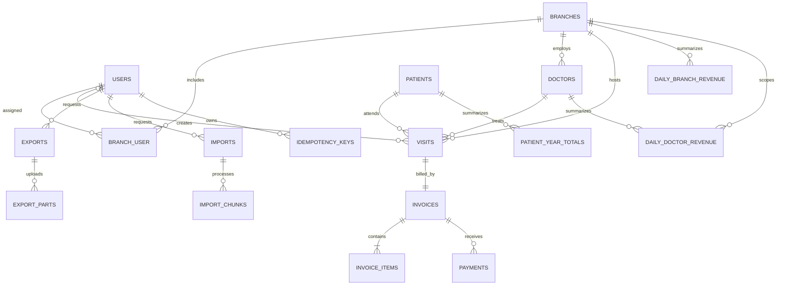

# Clinic Visits & Billing API — implementation plan

Status: Core schema and a small synthetic seed run exist in the development database. All seven assessment API routes plus import/export routes, a reviewer-token command, policies, validation, resources, transactional visit creation, reports and queued transfer jobs are coded. Existing database-free access tests pass. The new idempotency, exports and imports migrations are pending. Database-backed API/transfer tests require a separate MariaDB test database and have not run; S3/SQS, worker restart, full-volume throughput, EXPLAIN targets and AWS deployment remain unverified. No frontend is planned.

## 1. Decisions before implementation

- Database connection verified: `assignment`, server `12.2.2-MariaDB`. Use this existing connection for development as requested. Use a separate MariaDB database for tests. No database replacement or version-matching prerequisite.
- Use Laravel 13.43.0, PHP constraint `^8.4`, and installed PHP 8.4.19. Preserve PHP 8.5 compatibility. The user explicitly chose the current stack on 19 November 2026; proceed without downgrading or waiting for stack approval. Document actual versions with benchmark results.
- Core deliverable is the assessment API. No frontend is required.
- Keep one application, ordinary Eloquent models, Form Requests, API Resources, small injected services, and queued jobs. No repository interfaces, generic CRUD framework, or unnecessary abstractions.
- Dependencies verified installed: Sanctum 4.5.0 for tokens; S3 Flysystem adapter 3.35.3 and AWS SDK 3.405.0 for S3/SQS; Boost 2.10.4 for development guidelines/tools. PHPUnit/Pint are installed. Generated Boost guidelines have been read; MCP configuration exists, but Boost tools are not connected in this agent session.
- Prefer SQS for deployment queues and database-backed job progress. Redis is optional and unnecessary initially. Local SQS integration can use a development queue; tests fake queue/storage.
- No `.git` directory currently exists here. Initialize Git and commit each completed step during implementation; publishing and collaborator access are separate user actions.
- If received on 19 November 2026, the five-calendar-day deadline is 24 November 2026; confirm the submission time.

## 2. Code style review and rules to follow

This is a targeted style review, not a security audit of the reference application.

| Reference | Keep | Adapt for this assessment |
|---|---|---|
| `app/Services/PortalUserSyncService.php:16` | Named business methods, explicit arrays, Eloquent, parameter/return types | Use injected services and short methods |
| `app/Services/ActivityWriter.php:14` | Straightforward field mapping and defaults | Keep sensitive patient values out of logs |
| `app/Models/InvoicePayment.php:12` | Explicit fillable fields | Add casts, typed relationships, consistent spacing |
| `app/Models/MdrInvoice.php:32` | Normal Eloquent relationships | Consistent camelCase relationship names |
| `app/Http/Controllers/PortalUserSyncController.php:11` | Controller delegates business work | Form Request + Resource; do not expose exception messages as at line 27 |
| `app/Imports/DeviceImport.php:106` | Explicit validation and mapping | Replace per-row lookups/writes with bounded batch validation/upserts |
| `app/Jobs/FileUpload.php:25` | Separate background work | Queue record IDs/S3 keys, not uploaded-file objects/local request files |
| `tests/Feature/MdrCertificateDownloadTest.php` | Named tests and concrete assertions | Add real HTTP feature tests using an isolated MariaDB test database |

Use `index`, `show`, `store`; explicit `if` conditions; small methods; validated arrays; `$fillable`; PHP type hints; normal Laravel exception handling. Query Builder is appropriate for reports and bulk writes, inside services/commands. Use one service per business area, without adding a second action layer. Configure Pint for the assessment's PSR-12 requirement. Avoid copying legacy response wrappers when API Resources already provide the response structure.

## 3. Define the API contract and accounting rules

Write these assumptions into README/OpenAPI before coding:

- One healthcare group; clinic staff access visits/billing only within assigned branches, system admins access all branches. A minimal shared patient directory allows first visits at another branch; clinical history remains branch-scoped. Use `branch_user` and Policies; see the role matrix and patient visibility rules in section 4A.
- All assessment API endpoints use Sanctum bearer-token authentication, Form Requests, Resources and rate limits. Issue the reviewer token through a CLI command. No public registration is required.
- MRN, CPR and phone are strings, preserving leading zeros. Exact normalized MRN/CPR/phone search; literal name-prefix search. Phone need not be unique. CPR uniqueness is an explicit assumption.
- Return masked CPR/phone by default. Use synthetic data only. Do not log search values, authorization headers, request bodies, or signed URLs; redact query strings in Nginx/application logs. Encrypt storage/backups and require TLS. Field-level encryption is an optional later requirement: encrypted casts alone cannot support indexed exact search.
- Use a single configured currency. BHD with three decimal places is a proposed assumption, not a PDF requirement. Store all monetary values as integer minor units in BIGINT columns; accept/return decimal strings. Integer quantities initially; reject excessive amounts/quantities before multiplication.
- Gross = sum(quantity × unit price); net = gross − discount + VAT; outstanding = net − paid. Validate discount ≤ gross; calculate VAT using integer basis points and a documented rounding rule. Never accept client-calculated totals. Currency/VAT configuration is not a legal tax determination.
- Store timestamps in UTC. Reports use the invoice billing date in a documented reporting timezone. Treat the inclusive `to` date as an exclusive next-day boundary. Support any rolling one-year range, including ranges crossing December/January; do not restrict both dates to the same calendar year. Define the maximum exclusive end as the start plus one calendar year, with documented leap-day handling.
- Revenue reports include non-void invoices billed in the selected range; paid is payments allocated to those invoices as of report generation, not cash received within the date range. Outstanding follows the same basis. Top patients uses the same net-billing inclusion rule.
- Cursor pagination means next/previous navigation, not arbitrary `page=10000` jumps. Document this explicitly.

## 4. Write schema files — do not execute them

Required business volume: **30,001,025 rows**, before summary/operational tables.

| Table | Required rows | Main columns/constraints |
|---|---:|---|
| branches | 25 | id, name, city, timezone |
| doctors | 1,000 | id, branch_id FK, name, specialty |
| patients | 1,000,000 | id, unique MRN, unique normalized CPR, phone, name, DOB DATE, gender |
| visits | 5,000,000 | id, patient_id/doctor_id/branch_id FKs, visit_date DATETIME, status |
| invoices | 5,000,000 | id, unique visit_id FK, billing_date, currency, total/discount/VAT/net minor units, status |
| invoice_items | 15,000,000 | id, invoice_id FK, service_code, integer qty, unit_price minor units |
| payments | 4,000,000 | id, invoice_id FK, method, amount minor units, paid_at |

Use matching unsigned BIGINT FK types, bounded strings, explicit nullability, and restrictive deletion for clinical/billing history. Validate that the doctor belongs to the chosen branch. Doctor branch membership is fixed for this assessment; visits retain their historical branch.

Initial indexes, verified later against actual query plans:

- Patients: unique MRN/CPR; phone; `(name, id)` for prefix search.
- Visits: `(patient_id, visit_date, id)`, `(visit_date, id)`, `(branch_id, visit_date, id)`, `(doctor_id, visit_date, id)`, `(status, visit_date, id)`.
- Benchmark branch+status and doctor+status filters; add corresponding equality-column/date/id composites only when necessary. One wide composite does not solve all optional-filter combinations.
- Invoices: unique visit_id; `(billing_date, id)` for report rebuilds.
- Items/payments: invoice_id indexes for invoice detail; other indexes only when a query needs them.

Operational tables: token/branch access tables, idempotency records, seed progress, imports, exports, and bounded chunk progress. Job rows include owner, status, progress, retry state, timestamps, safe error code, and private S3 object key.

Summary tables:

- `daily_branch_revenue`: unique `(billing_date, branch_id)`.
- `daily_doctor_revenue`: unique `(billing_date, doctor_id)` plus branch_id for access filtering; verify indexes for scoped reports.
- `patient_year_totals`: unique `(year, patient_id)` and `(year, net_minor DESC, patient_id)` for top 100. Top-patients reporting is system-admin-only initially, avoiding incorrect cross-branch totals.

### 4A. User accounts and authorization

Proposed application roles below are design decisions; the PDF requires authorization but does not prescribe role names. Use three string values in `users.role`, backed by one PHP enum and Policies. No roles/permissions package or separate admin login table is needed.

| Role | Purpose | Data scope |
|---|---|---|
| `admin` | System/group administrator and assessment reviewer | All branches |
| `clinic_admin` | Clinic manager | Branches explicitly assigned through `branch_user` |
| `clinic_user` | Reception/billing staff | Branches explicitly assigned through `branch_user` |

| Capability | admin | clinic_admin | clinic_user |
|---|---|---|---|
| Search minimal patient directory | Yes | Yes | Yes |
| Read patient visits and invoices | All branches | Assigned branches | Assigned branches |
| Create visit with invoice/items | All branches | Assigned branches | Assigned branches |
| Revenue by branch/doctor/month | All branches | Assigned branches | No |
| Top 100 patients across group | Yes | No | No |
| Export visits | All branches | Assigned branches | No |
| Import/upsert shared patient master data | Yes | No | No |
| Manage accounts/branch assignments | Yes, via CLI initially | No | No |
| Change roles or grant global access | Yes, via CLI initially | No | No |

- One role per user, consistent across all their assigned branches. `branch_user` supports multiple branches without putting a comma-separated list in `users`. Global admins need no branch assignments.
- Clinic admins manage clinic operations/reporting, not global identities. User-management HTTP endpoints/UI are outside this assessment; create/deactivate accounts and assign branches through a small authenticated-operator CLI workflow.
- Patients and doctors are business records, not `users`. No patient portal, doctor login, separate finance role, or public registration in the initial scope.
- Shared patient search returns only ID, MRN, name and masked CPR/phone; DOB/gender/full identifiers are omitted by default. Exact identifier search is rate-limited. This shared directory is an explicit single-group assumption, not permission to read another clinic's clinical history.
- `/patients/{id}/visits` always filters visits by allowed branch IDs. An existing patient with no visible visits yields an empty collection. Invoice/item/payment access follows the invoice's visit branch. Out-of-scope invoice/visit IDs return 404; forbidden capabilities return 403.
- Branch filters narrow existing authorization; they never grant access. Validate doctor/branch pairing. Submitted `role`, `user_id`, `created_by` and unrestricted branch lists are never trusted.
- Recheck current `is_active`, role, branch scope and token abilities on every request. Jobs check current authorization at processing time; scope changes invalidate/restart affected exports. Downloads require current authorization, ownership (or global admin), and a short-lived URL. Already-issued URLs remain usable until expiry; keep expiry short.
- Jobs contain the requesting user's ID and authorized scope, never a serialized authenticated session. Store original scope for auditing; reject an export if its original scope is no longer authorized rather than exposing a partially broader file.
- Initial manual demo accounts: one system admin, one clinic admin and one clinic user for branch A, plus a clinic user for branch B to test isolation. Creating one admin per each of 25 branches is optional, not an assignment requirement. Use unique passwords/tokens; do not put credentials in the plan or Git.
- Account deactivation replaces deletion, preserves attribution and denies existing tokens; revoke tokens as part of the same management workflow. Add Sanctum `HasApiTokens` to User during implementation.

### 4B. Column definitions and constraints

Notation: `id` = auto-increment unsigned BIGINT primary key; FK columns use unsigned BIGINT. Fields are NOT NULL unless marked nullable. `timestamps` = `created_at`, `updated_at`, UTC DATETIME, populated on every insert including bulk inserts. InnoDB/utf8mb4; use a documented case-insensitive collation for human names and normalized, consistently compared identifiers. Keep existing Laravel framework-table conventions where already generated.

Money: all `*_minor` fields are signed BIGINT with nonnegative validation/CHECK constraints on source amounts. Signed storage permits safe intermediate subtraction; outstanding is calculated, not a second writable column. Enforce practical upper bounds in Form Requests/services. All data uses one currency/scale; do not mix currencies in summaries. The proposed BHD scale is 3.

| Table | Required columns | Nullable columns / defaults | Constraints and indexes |
|---|---|---|---|
| `users` | id, name VARCHAR(150), email VARCHAR(255), password VARCHAR(255), role VARCHAR(20), is_active BOOLEAN, timestamps | email_verified_at DATETIME, remember_token VARCHAR(100); role=`clinic_user`, is_active=true | Unique email; role allowlist; server-controlled role/is_active |
| `branches` | id, code VARCHAR(20), name VARCHAR(150), city VARCHAR(100), timezone VARCHAR(64), is_active BOOLEAN, timestamps | is_active=true | Unique code; valid IANA timezone |
| `branch_user` | user_id FK users, branch_id FK branches, timestamps | None | Composite PK `(user_id, branch_id)`; reverse index `(branch_id, user_id)` |
| `doctors` | id, branch_id FK branches, name VARCHAR(150), specialty VARCHAR(100), is_active BOOLEAN, timestamps | is_active=true | Index branch_id; unique `(id, branch_id)` supports visit branch-consistency FK |
| `patients` | id, mrn VARCHAR(32), cpr VARCHAR(32), name VARCHAR(150), phone VARCHAR(32), dob DATE, gender VARCHAR(20), timestamps | None | Unique mrn; unique cpr; phone index; `(name, id)` index; DOB not in future |
| `visits` | id, patient_id FK patients, doctor_id, branch_id FK branches, visit_date DATETIME, status VARCHAR(20), timestamps | created_by FK users nullable for bulk synthetic records | Composite FK `(doctor_id, branch_id)` to doctors; patient/branch FKs; query indexes listed above; FK index `(doctor_id, branch_id)` |
| `invoices` | id, visit_id FK visits, billing_date DATE, currency CHAR(3), total_minor BIGINT, discount_minor BIGINT, vat_rate_bps UNSIGNED SMALLINT, vat_minor BIGINT, net_minor BIGINT, status VARCHAR(20), timestamps | discount_minor=0, vat_minor=0; amounts/rate/status explicitly derived by writer | Unique visit_id; `(billing_date, id)`; discount<=total; net=total-discount+VAT |
| `invoice_items` | id, invoice_id FK invoices, service_code VARCHAR(40), qty UNSIGNED INT, unit_price_minor BIGINT, timestamps | None | invoice_id index; qty>0; unit_price>=0; bounded item count per invoice |
| `payments` | id, invoice_id FK invoices, method VARCHAR(20), amount_minor BIGINT, paid_at DATETIME, timestamps | reference VARCHAR(100) nullable | invoice_id index; amount>0; method allowlist; sum(payments)<=invoice.net under invoice lock |

- `cpr` is a normalized national-ID string, not an integer; use synthetic values for the assessment. Do not assume every country has a nine-digit national ID. Phone normalization uses a documented country-code rule. Shared phone numbers are allowed.
- Gender values: `male`, `female`, `other`, `unknown`; visit status: `scheduled`, `completed`, `cancelled`; invoice status: `unpaid`, `partially_paid`, `paid`, `void`; payment method: `cash`, `card`, `insurance`. Validate allowlists through PHP enums/Form Requests and explicit DB CHECK constraints where appropriate.
- Every created visit receives one invoice in the same transaction; unique `visit_id` enforces at most one. The database alone cannot enforce that every visit has an invoice, so test transactional creation and seed reconciliation.
- Invoice numbers are not required: expose invoice ID initially. Item totals are computed from integer qty/unit price; do not store duplicate mutable line totals.
- `billing_date` is set from visit time in the configured reporting timezone and remains stable. Branch timezone is descriptive and used for local display, not to silently change the reporting basis.
- A cancelled visit has a void invoice under the initial assumption. No payment on a void invoice. Refunds, write-offs, overpayments and billing edits are outside initial endpoints; they require an explicit later accounting design.
- Zero-net non-void invoices are `paid`. Otherwise status derives from allocated payment totals. Any future payment API locks the invoice and updates summaries in the same transaction; no payment-create endpoint is required now.
- Branches/doctors/users deactivate instead of deleting; existing history remains readable. Reject new visits for inactive branches/doctors. Source clinical/billing FKs use RESTRICT on delete. No automatic cascade deleting visits, invoices, items or payments. Avoid soft-delete columns on the large source tables initially.
- `created_by` on visits records the authenticated creator; invoices/items inherit attribution through the visit. Do not duplicate patient_id/branch_id/doctor_id on invoices: reach them through visit. Summary branch_id is deliberate denormalization.

### 4C. Summary and operational columns

These are supporting tables in addition to the seven required business tables. Create job-related tables only when implementing that feature.

| Table | Columns | Keys / behavior |
|---|---|---|
| `daily_branch_revenue` | billing_date DATE, branch_id FK, invoice_count UNSIGNED BIGINT, gross_minor/discount_minor/vat_minor/net_minor/paid_minor BIGINT, updated_at DATETIME | Composite PK `(billing_date, branch_id)`; `(branch_id, billing_date)` for scoped reports; zero defaults on counters; outstanding=net-paid |
| `daily_doctor_revenue` | billing_date DATE, doctor_id FK, branch_id FK, same count/money fields as branch summary, updated_at DATETIME | Composite PK `(billing_date, doctor_id)`; `(branch_id, billing_date, doctor_id)`; consistent doctor/branch pair |
| `patient_year_totals` | year UNSIGNED SMALLINT, patient_id FK, invoice_count UNSIGNED BIGINT, net_minor BIGINT, updated_at DATETIME | Composite PK `(year, patient_id)`; `(year, net_minor DESC, patient_id)`; global-admin reporting only |
| `idempotency_keys` | id, user_id FK, endpoint VARCHAR(80), key_hash CHAR(64), request_hash CHAR(64), response_status UNSIGNED SMALLINT, response_body JSON, timestamps | Unique `(user_id, endpoint, key_hash)`; response fields nullable only while transaction is open; failed transaction rolls back reservation; no medical identifiers in response snapshot |
| `seed_runs` | id, run_key VARCHAR(64), config JSON, config_hash CHAR(64), phase VARCHAR(30), last_committed_id UNSIGNED BIGINT, row_counts JSON, metrics JSON, status VARCHAR(20), started_at DATETIME, timestamps | Unique run_key; completed_at DATETIME and error_code VARCHAR(80) nullable; configuration includes generator version/random seed/frozen five-year range/counts; metrics include active_elapsed_ms, phase timings and peak_memory_bytes; checkpoint/counters/metrics updated in batch transaction |
| `exports` | id, user_id FK, filters JSON, branch_scope JSON, status VARCHAR(20), rows_processed UNSIGNED BIGINT, max_visit_id UNSIGNED BIGINT, disk VARCHAR(20), object_key VARCHAR(512), timestamps | Nullable last_visit_date DATETIME, last_visit_id UNSIGNED BIGINT, multipart_upload_id TEXT, started_at/completed_at/heartbeat_at DATETIME, lease_token CHAR(36), lease_expires_at DATETIME, error_code VARCHAR(80); unique object_key; index `(user_id, created_at)`, `(status, updated_at)` |
| `export_parts` | id, export_id FK, part_number UNSIGNED INT, etag VARCHAR(128), byte_count UNSIGNED BIGINT, row_count UNSIGNED INT, end_visit_date DATETIME, end_visit_id UNSIGNED BIGINT, created_at DATETIME | Unique `(export_id, part_number)`; checkpoint and part ledger commit together after S3 upload; record first/start cursor when needed for deterministic replay |
| `imports` | id, user_id FK, disk VARCHAR(20), object_key VARCHAR(512), source_bytes UNSIGNED BIGINT, source_etag VARCHAR(128), status VARCHAR(20), next_byte_offset UNSIGNED BIGINT, processed_rows/valid_rows/invalid_rows UNSIGNED BIGINT, timestamps | Nullable source_version_id TEXT, source_checksum VARCHAR(128), error_object_key VARCHAR(512), started_at/completed_at/heartbeat_at DATETIME, lease_token CHAR(36), lease_expires_at DATETIME, error_code VARCHAR(80); index `(user_id, created_at)`, `(status, updated_at)` |
| `import_chunks` | id, import_id FK, chunk_number UNSIGNED INT, start_byte/end_byte UNSIGNED BIGINT, first_row UNSIGNED BIGINT, row_count/valid_rows/invalid_rows UNSIGNED INT, created_at DATETIME | Unique `(import_id, chunk_number)`; error_object_key VARCHAR(512) nullable; committed row means patient changes and progress committed together |

- Summary amounts are nonnegative committed totals, initially zero. Exclude void invoices; apply deltas only once. The canonical source remains invoices/items/payments. Summary rows can be rebuilt and have RESTRICT FKs to their dimensions.
- Operational job status values are `queued`, `processing`, `done`, `failed`. Counters default to zero. S3 keys store paths, not presigned URLs; generate URLs on authorized retrieval. JSON stores only bounded configuration/filters, never CSV rows or whole datasets.
- Lease token/expiry identify the current worker; checkpoint updates require matching ownership. Serialize imports with one shared DB-backed lock in addition to per-import leases. Seed command also holds a shared lock so a second run cannot overlap the same target database.
- A seed configuration change requires a different empty target/run, not resetting the checkpoint. Final exact source counts and relationships are checked before marking done.
- Retain Laravel's generated `personal_access_tokens` schema: id, tokenable_type/id, name, unique token hash, nullable abilities/last_used_at/expires_at, timestamps. Add token abilities only as a restriction on role permissions, never a privilege grant. Sanctum's polymorphic token ownership has no normal users FK; deactivate/revoke explicitly.
- Keep existing framework cache and queue tables where used. The assessment API uses bearer tokens; public registration/password-reset screens are outside scope.
- Job chunk FKs may cascade only when explicitly purging expired operational jobs; clinical data never cascades. S3 cleanup is a separate retryable operation. User references on jobs/idempotency use RESTRICT; deactivate accounts instead of deleting them.

### 4D. Relationships and creation order



The diagram expresses business invariants; one invoice per visit and at least one item are enforced by transactional application code as well as the relevant unique/FK constraints. A patient has many visits across the five-year period, one invoice per visit, and zero or more payments per invoice. Thus one patient can have many invoices and many payments, including multiple partial payments on one invoice. Payments belong to an invoice, not directly to the patient; resolve patient ownership through invoice -> visit -> patient and prevent mismatched ownership.

| Model | Planned relationship methods |
|---|---|
| User | `branches(): BelongsToMany`, `createdVisits(): HasMany`, `imports(): HasMany`, `exports(): HasMany`; Sanctum `tokens()` |
| Branch | `users(): BelongsToMany`, `doctors(): HasMany`, `visits(): HasMany` |
| Doctor | `branch(): BelongsTo`, `visits(): HasMany` |
| Patient | `visits(): HasMany`, `invoices(): HasManyThrough` through visits, `yearTotals(): HasMany`; patient payments retrieved through invoice/visit joins in the service |
| Visit | `patient(): BelongsTo`, `doctor(): BelongsTo`, `branch(): BelongsTo`, `creator(): BelongsTo`, `invoice(): HasOne` |
| Invoice | `visit(): BelongsTo`, `items(): HasMany`, `payments(): HasMany` |
| InvoiceItem / Payment | `invoice(): BelongsTo` |
| Import / Export | `user(): BelongsTo`, `chunks(): HasMany` / `parts(): HasMany` respectively |

Use explicit `created_by` foreign key for `Visit::creator`. Composite primary-key summary/pivot tables can use Query Builder for writes; do not invent unsupported composite-key Eloquent behavior. No patient-branch ownership FK: patients are group-wide, visits establish clinical branch access.

Prepare migrations in dependency order: (1) users adjustments + branches, (2) branch_user + doctors + patients, (3) visits, (4) invoices, (5) items + payments, (6) summaries, (7) idempotency + seed progress, (8) import/export records then chunk tables. Existing framework/token migrations remain. Review generated SQL/types/indexes before you manually run migrations; no schema or seed execution by the agent.

### 4E. One patient visiting multiple branches

Required flow: one global patient record and MRN across the healthcare group. The same patient can visit branch A, then branch B, then return to branch A over the five-year history. Changing the visited branch never creates a duplicate patient or transfers previous visits/invoices to the new branch.

1. Staff at branch B find the existing patient through the shared, masked patient directory using MRN/CPR/phone/name search.
2. Staff select an active branch they are authorized to use, and an active doctor belonging to that branch.
3. `POST /api/visits` receives the existing `patient_id`, selected `branch_id`, matching `doctor_id`, visit date/status and invoice items. Having previous visits only in branch A does not prevent a first visit in branch B.
4. The service creates a new visit and its invoice/items in one transaction. Existing branch A records remain unchanged. Payments reference the specific invoice, so payments for visits at different branches never mix.
5. Revenue/doctor summaries attribute the new invoice and its payments to branch B through this visit. Patient annual totals combine eligible invoices across branches for system-admin reporting only.

Migration requirements:

- Keep `patients` independent of a branch: no required `patients.branch_id` and no patient-branch ownership constraint.
- Keep `visits.patient_id` non-unique so a patient can have many visits; store `branch_id` on every visit. Do not add a unique `(patient_id, branch_id)` constraint, because repeat visits to the same branch are valid.
- Keep unique patient MRN/CPR across the group, unique `invoices.visit_id`, and the composite doctor/branch FK. A doctor from branch A cannot be used for a branch B visit.
- Individual `create_patients_table` and `create_visits_table` migrations already have this structure; no new table or schema alteration is needed for cross-branch visits. Clinic tables use separate migrations in dependency order. The existing patient/date and branch/date indexes support their respective histories; benchmark combined patient+branch filters before adding another large index.
- `branch_user` controls staff access only. Do not use it for patients or add a patient-branch pivot just to record visits; visits already provide that association.

Relationships and visibility:

- `Patient::visits()` includes all visits at the model relationship level; services apply the current user's branch scope before returning records.
- `Patient::invoices()` reaches invoices through visits. Patient payments are queried through invoices and visits, with the same authorized branch scope.
- `Branch::visits()`, `Visit::patient()`, `Visit::branch()` and `Visit::doctor()` remain the source relationships. To list a patient's visited branches, query distinct branches through authorized visits; avoid duplicate branches from repeated visits.
- System admin sees the patient's history across all branches. Clinic staff see only visits/invoices/payments within their assigned branches. Cross-branch patient identity sharing does not grant access to another branch's medical/billing history. A user assigned to A and B sees both, with branch names on each visit.

Seeder requirements:

- Explicitly generate cross-branch histories rather than assigning every visit of a patient to one permanent branch. Proposed deterministic sample: 20% of patients having at least two visits receive visits in at least two distinct branches; the remaining patients may stay within one branch. This percentage is a fixture choice, not a PDF requirement.
- Pick the doctor from the selected visit branch for every seeded visit. Preserve global patient IDs/MRNs, the five-year timestamp rules, exact target counts, one invoice per visit, and valid invoice-linked payments.
- Include repeat returns to a previous branch and cross-branch patients with partial/full payments. Derive branch choices deterministically from patient/visit sequence and the saved seed configuration, without retaining all patient visits in memory.
- Add a small deterministic A -> B -> A scenario for manual review/tests. Validate cross-branch sample counts with `COUNT(DISTINCT branch_id)` grouped by patient on the database, without collecting millions of grouped rows into PHP.
- Seed final output includes the number of patients visiting multiple branches alongside normal counts/timing. Include this verification time in the full-run benchmark.

Acceptance checks: same patient/MRN has visits at A and B; doctor/branch mismatch is rejected; unrelated staff cannot create a visit for B or read B's invoice; first visit at B is allowed for B's staff; repeat A visits remain allowed; branch revenue stays separate while system-admin patient totals reconcile across both branches. These are planned checks, not executed tests.

### 4F. Branch hours, doctor availability, leave and closures

- Separate migrations define `branch_hours`, `doctor_availabilities`, `doctor_leaves` and `branch_closures`; these are supporting tables outside the required business-row counts.
- Weekly hours use ISO weekdays: 1 = Monday through 7 = Sunday. Times are local to `branches.timezone`; doctor availability uses the doctor's branch timezone. Multiple non-overlapping periods support split shifts. No weekly rows for a day means closed/unavailable.
- Weekly periods are start-inclusive/end-exclusive. Split overnight shifts at midnight into two weekday rows; `24:00:00` is allowed only as an end-of-day boundary. Unique owner/day/start indexes prevent duplicate starts; CHECK constraints validate weekdays and time ordering.
- Leave and closures store UTC `starts_at`/`ends_at` and an optional internal reason. Convert local input using the branch timezone. Full-day periods run from local midnight to the following midnight; partial-day and multi-day periods use the same fields. End is exclusive. A closure overrides branch hours; leave overrides doctor availability.
- Effective availability is the intersection of branch hours and doctor hours, minus branch closures and doctor leave. The doctor remains assigned to one branch. Leave reasons must not appear in shared patient-directory or public availability responses.
- Schedule management and visit-time enforcement belong to the upcoming services/Policies increment: validate overlapping weekly periods under an owner-row lock, reject doctor hours outside branch hours, revalidate when branch hours change, and check active branch/doctor plus effective availability for new scheduled visits. Schedule changes must flag affected future visits for review rather than silently cancel or move them. Historical visits remain unchanged.
- This schema does not implement appointment slots or prevent double booking; visit duration/capacity are outside the current API contract. Test split shifts, midnight boundaries, leave/closure overrides and timezone conversion when implementing schedule services. Synthetic historical visits must not be rejected against today's weekly schedule.
- Status: scheduling migration files prepared; schedule services, authorization and integration tests remain pending.

## 5. Build and benchmark the seed command early

Implement `data:seed --patients=1000000 --visits=5000000`, with optional documented batch size/run identifier.

- Deterministic synthetic data covering the last FIVE YEARS up to the start of the seed run. Capture `range_end=now()` once and `range_start=range_end minus five calendar years`, store both in `seed_runs.config`, and reuse them unchanged on resume. Example for a run started on 19 November 2026: 19 November 2021 through the captured time on 19 November 2026. Never recalculate the range during individual batches.
- Spread visits/invoices/payments and their applicable business timestamps across all years/months in that window, through the current cutoff; no future transactions. Parent registration/creation dates precede dependent visits; invoice/item creation follows the visit; payments follow the invoice and never exceed the cutoff. Keep `updated_at >= created_at`. DOB represents a realistic birth date and can precede the five-year window; it must precede the patient's visits. This avoids incorrectly making every patient five years old or younger.
- Allocate visits so most patients have 2–5 and a small documented tail has 50+; verify the distribution and exact requested total.
- One invoice and three items per visit. Generate at least 4,000,000 payment rows for the default 5,000,000 visits, distributed over eligible invoices with zero, one or multiple payments. For scaled trials, target `floor(visits * 0.8)` payment rows; this is a row count, not an assumption that exactly 80% of invoices have one payment. Include unpaid, partially paid and fully paid invoices without overpayment. Distribute repeat patients' visits, invoices and payments across different months/years; totals, ownership and statuses must agree.
- Stream bounded batches, initially 1,000–5,000 rows. Generate IDs without loading all patients/visits. Avoid per-record factories/events and query logging.
- Console progress is required on local and server runs: current table/phase, committed rows versus target, percentage, total committed rows, elapsed time, rows/second and estimated remaining time. Refresh once per batch or at a bounded time interval, not once per row. Show resumed committed counts immediately; rolled-back/retried rows must not inflate progress.
- On completion print and persist a summary: rows per table, combined business rows, date range, total duration in seconds and HH:MM:SS, phase durations, peak memory, and whether the full run was below 1,800 seconds. Report success only after required counts, ownership relationships and monetary totals reconcile. Failure/interruption reports the last committed checkpoint and elapsed duration; resume does not label existing rows as newly inserted.
- Store cumulative active elapsed milliseconds/phase timings in the seed-run metrics and retain first-start/completion times. Report active execution time separately from end-to-end wall time on resumed runs. The under-30-minute assessment result must come from a fresh uninterrupted full run, including generation, inserts, required indexes/summaries and final validation; do not claim compliance by excluding slow phases or pauses.
- Save a seed-run configuration and next committed batch. Commit each batch and its checkpoint together. A rerun resumes the same configuration or reports completion; reject changed parameters and overlapping runs. Never truncate an existing populated database.
- Parent rows precede child rows; reconcile all FK relationships. Use a dedicated empty synthetic-data database/run so seed IDs cannot overwrite application data.
- First benchmark Query Builder multi-row inserts. If throughput is inadequate, implement a dedicated CLI-only `LOAD DATA LOCAL INFILE` path using bounded generated files and validated staging data; include staging/index/summary work in measurements. RDS supports this approach, subject to client/server configuration. [AWS import guidance](https://docs.aws.amazon.com/AmazonRDS/latest/UserGuide/mysql-importing-data-any-source.html)
- Target is roughly 16,667 business rows/second for 30 million rows in 30 minutes. This is a benchmark target, not a promise. Keep backups/durability enabled; document hardware, storage/IOPS, CPU credits, peak memory, generation/load/index/summary times, and full elapsed time.
- Run small, medium, then full-volume trials manually. Record exact committed row counts separately from InnoDB `information_schema` estimates; record data/index MB from `information_schema`.

## 6. Implement the four read endpoints

| Endpoint | Implementation | p95 target |
|---|---|---:|
| GET /api/patients?search= | Indexed exact identifiers/name prefix; bounded results; escape LIKE wildcards; EXPLAIN the combined predicates and split into indexed candidate queries if needed | <200 ms |
| GET /api/patients/{id}/visits | Authorization scope, cursor pagination; return visit date/status, doctor, branch, invoice ID and invoice total explicitly; eager-load selected relations | <150 ms |
| GET /api/visits | Shared VisitService filter builder, validated optional filters, stable `(visit_date DESC, id DESC)` cursor order; default 50/max 100 | <300 ms |
| GET /api/invoices/{id} | InvoiceResource with bounded related items/payments loaded explicitly; authorization and query-count check | <100 ms |

Use direct timestamp ranges, not functions wrapped around indexed date columns. Paginate before expensive related loading. Do not calculate total-count queries for every cursor page. Validate malformed cursors and prohibit unsupported sort columns. Deep-page measurement uses a cursor at equivalent depth, with cursor discovery measured separately. [Laravel cursor pagination](https://laravel.com/framework/docs/13.x/pagination)

## 7. Implement transactional visit creation

`POST /api/visits` → StoreVisitRequest → VisitService → VisitResource.

- Validate patient, doctor/branch membership, permissions, status, date, item limits, service codes, prices and discount.
- Require bounded `Idempotency-Key`; unique scope `(user_id, endpoint, key_hash)` and normalized validated-payload hash.
- Within one DB transaction: reserve key, create visit/invoice/items, update affected summaries, and save the stable response/status.
- Same key + same payload replays the original result; same key + changed payload returns 409. Concurrent identical requests must create exactly one visit/invoice. Rollback must leave no orphan records or summary increments.
- Resolve duplicate-key races from committed state after rollback; retry transient deadlocks only within a bounded policy. Do not implement idempotency as an unlocked check-then-insert.
- Define key retention/replay behavior explicitly; retain keys throughout the assessment.

## 8. Implement the two reports

Use the assignment's exact routes and parameter names:

| Method and route | Required query parameters | Response / p95 target |
|---|---|---|
| `GET /api/reports/revenue` | `from=YYYY-MM-DD`, `to=YYYY-MM-DD`, `group_by=branch` or `doctor` or `month` | Gross, discount, VAT, net, paid, outstanding per group; <1 s for any one-year range |
| `GET /api/reports/top-patients` | `year=YYYY` | Top 100 patients by net billing, stable tie order; <1 s |

Document these exact paths in OpenAPI/Postman and README; test them as HTTP endpoints. Revenue example: `/api/reports/revenue?from=2025-07-01&to=2026-06-30&group_by=branch`. Top-patients example: `/api/reports/top-patients?year=2026`. Partial current-year results stop at available data; do not generate future records to fill a year.

- Revenue by branch/month reads daily branch summaries; by doctor reads daily doctor summaries. Include gross, discount, VAT, net, paid and outstanding, plus reporting basis/as-of time.
- Top patients reads indexed annual totals, then fetches names for only the selected 100 IDs; deterministic ties by patient ID.
- For this small write API, update summaries synchronously inside the billing transaction. This avoids scheduler lag in normal writes. Any future payment/status writer must use the same summary-update service.
- Bulk seed initializes/reconciles summaries before success. Provide a manual, resumable rebuild that builds replacement summaries without exposing half-built results; document whether writes must pause during rebuild.
- Do not join raw invoice_items and payments together before summing: multiple child rows multiply amounts.
- Both targets are <1 second. Reconcile summaries against source records on fixtures and representative full-data ranges. Caching is an optional measured optimization, not a substitute for correct summaries.

## 9. Implement resumable export/import

S3 purpose:

- Store uploaded patient CSV files for background import.
- Store generated visit CSV exports, including files with 2M+ rows.
- Store downloadable import error reports.
- Keep files private; grant short-lived upload/download access through presigned URLs.
- Keep source/result files available independently of a web request, worker restart, or application release. Job progress and billing/patient records remain in the database; SQS delivers background jobs.
- S3 is object storage, not the application database. Start core API development without AWS credentials; use Laravel storage fakes for tests and connect a real private bucket when implementing the AWS transfer flow.

Export:

- `POST /api/exports/visits` validates the same filters as VisitService, saves the authorized scope, returns 202, then dispatches after commit.
- `GET /api/exports/{id}` enforces ownership/permission and returns queued/processing/done/failed plus an expiring download URL when done.
- Chunk by stable visit cursor with a persisted maximum visit ID; newer visits are excluded. Document that related mutable values reflect processing time, not a database-wide historical snapshot.
- Stream CSV to bounded multipart S3 parts; persist upload ID, part number/ETag and next cursor. Retry replaces the same part rather than appending rows twice. Reconcile completion after a crash using the deterministic object key and S3 metadata.
- Respect S3 minimum part sizes and part-count limits; tune by bytes, not only row count. Keep a single final CSV with one header. [S3 multipart limits](https://docs.aws.amazon.com/AmazonS3/latest/userguide/qfacts.html?trk=public_post_comment-text)

Import:

- Add an authenticated upload-URL endpoint for a server-generated owner-scoped S3 key; then `POST /api/imports/patients` accepts that completed object reference and returns 202. Add `GET /api/imports/{id}` for progress/error download.
- Verify ownership, object size/type, immutable version/checksum and required CSV headers. Reject arbitrary URLs/foreign object keys. Cap at 500,000 rows and document maximum bytes/field lengths.
- Parse uncompressed UTF-8 CSV with streaming CSV functions, including quoted multiline fields. Checkpoint at complete record boundaries; use S3 byte ranges to resume an immutable source.
- Validate in bounded batches, upsert strictly by MRN, preserve existing patient IDs, and treat CPR collisions with another MRN as row errors. Do not let MariaDB/MySQL upsert accidentally update a different unique-key match.
- Process each import sequentially; last valid duplicate MRN within that file wins. Serialize patient imports initially to make conflicts predictable.
- Commit patient changes and chunk progress together. Store error chunks under deterministic private S3 keys before committing their references; retry overwrites them. Produce a downloadable CSV of row number and safe error reason, with sensitive values masked.

Both flows: bounded job duration, persisted progress, overlap protection, safe retries/backoff, failure status, and cleanup of abandoned multipart uploads. Sanitize spreadsheet-formula cells in downloadable CSV. Never put CSV contents in queue payloads. A scheduler recovers queued/stale records if dispatch or a worker fails. Dispatch-after-commit alone is not atomic delivery; recovery closes that gap. Set worker timeout below SQS visibility timeout. [Laravel queue guidance](https://laravel.com/framework/docs/13.x/queues)

### 9A. Application security and response headers

Security requirements apply to the API. Headers supplement validation, escaping and authorization.

- Add `SecurityHeaders` middleware and register it centrally. Ensure policies also cover authentication failures and rendered 403/404/422/500 responses; verify error paths rather than assuming a normal response middleware catches every exception.
- Set `X-Content-Type-Options: nosniff`, `X-Frame-Options: DENY`, `Referrer-Policy: no-referrer`, and `Permissions-Policy: camera=(), microphone=(), geolocation=()`. Use `Cache-Control: no-store` on sensitive HTML/JSON/download-URL responses; static versioned assets may remain cacheable.
- Enable HSTS only on the HTTPS deployment after HTTPS works; do not force HSTS for local HTTP. Keep production/dev header settings in configuration.
- Do not use legacy `X-XSS-Protection: 1; mode=block` as the defense; leave it absent or explicitly disabled. Use contextual output escaping and CSP instead. [Deprecated XSS filter guidance](https://developer.mozilla.org/en-US/docs/Web/HTTP/Reference/Headers/X-XSS-Protection?region=united-states)
- JSON responses use the correct content type; CSV exports neutralize formula-like cells. Do not expose sensitive patient data in responses or logs.
- Authentication: require expiring Sanctum bearer tokens on assessment endpoints; revoke tokens when accounts are disabled. Bind SQL values and allowlist report grouping/sorting.
- Authorization: active-user middleware, Policies and branch-scoped queries. Validate identifiers, ownership and roles on every API path.
- Hide PHP version disclosure using `expose_php=Off` in the active web PHP configuration and remove `X-Powered-By` at the response/web-server layer. Middleware alone may not remove a header added outside Laravel. Verify actual HTTP headers after the configuration is applied. Also suppress detailed web-server version banners where configurable; this does not make the technology impossible to identify. [PHP configuration reference](https://www.php.net/manual/en/ini.core.php)
- Use clean Laravel routes, never public `.php` feature URLs. Web document root must be `public`; no exposed `.env`, vendor/source files, database files, phpinfo/debug pages or exception traces. Production `APP_DEBUG=false`; return safe messages and log redacted diagnostics privately. Server configuration remains a later manual/deployment task; no host configuration is changed during planning.

## 10. Tests and performance evidence

Write tests with implementation, not at the end. Required feature suites:

- Visits: each filter and combinations; invalid dates/status; authorization; equal timestamps; cursor boundaries without duplicates; bounded page size.
- Revenue: exact amounts, partial/unpaid/void invoices, multiple payments/items, all three groupings, date boundaries, leap years, empty results, permissions and summary/source reconciliation.
- Seed verification: five-year coverage through frozen cutoff, plausible DOB/parent dates, repeated patient histories, multiple payments per invoice, committed-only progress, persisted completion timing and restart accuracy. Check monthly/yearly distribution without loading all rows into PHP.
- Security verification: guest/disabled-user rejection, missing or expired bearer-token rejection, branch isolation, role restrictions, response headers and safe errors.
- Create visit: 201 success, integer rounding, invalid foreign relationships, rollback, replay, payload conflict, concurrent duplicate requests and exactly-once summary effects.
- Add focused import/export retry tests: crash after DB/S3 writes, duplicate deliveries, ownership, CPR conflicts, malformed CSV, formula injection and worker restart.
- PHP 8.4 and 8.5 CI matrix; isolated MariaDB integration database matching the development server. PHPUnit for behavior; Pint PSR-12 for formatting. Verify the chosen AWS database separately at deployment time; local measurements do not establish performance on a different server/engine.
- Tests using RefreshDatabase run migrations internally. Do not execute them under the current no-migration instruction; provide the commands for manual execution against a dedicated test database.
- Benchmark on the full required dataset and documented AWS setup, with concurrency, request counts, warm/cold cache, p50/p95, failures and query counts. Include selective/nonselective filters, equivalent page 10,000, one-year reports and a 2M+ export.
- README must contain real EXPLAIN/EXPLAIN ANALYZE evidence for endpoints 1, 3 and 5. Record seed time, memory and DB sizes. Leave results marked unmeasured until actually collected.

## 11. AWS delivery plan

- Ubuntu 24.04 EC2, Nginx, PHP-FPM, Supervisor, cron; same tested PHP release as local/CI.
- Select the RDS engine/version during deployment planning; the PDF requests MySQL 8, while current development uses MariaDB by user choice. This does not block local implementation. Keep RDS in private subnets with no public access; port 3306 accepts only the app security group. Backups on, TLS, encryption, and a documented custom parameter group. Use the assessment's t3.medium/db.t3.medium for seed timing and record the actual engine/version.
- SSH restricted to your IP; HTTPS with a domain/subdomain and valid certificate. Nginx root points to `public`; production debug disabled.
- Private S3 with Block Public Access, encryption and lifecycle cleanup; presigned transfers only. SQS with retry/dead-letter handling. EC2 IAM role restricted to required bucket prefixes/queues; no AWS access keys in `.env`.
- CloudWatch receives redacted Nginx/Laravel logs, with retention and at least one alarm. Track queue failures/age and RDS storage/CPU/IOPS.
- Repeatable release-directory deploy: install locked production dependencies, cache config/routes, switch symlink, gracefully restart workers, health check, rollback symlink if needed. Database changes remain an explicitly documented manual step, never hidden in the deploy script.
- Estimate cost using the selected region and actual EC2/RDS/storage/backups/S3/SQS/logs/IP usage before provisioning. Do not assume 30M rows fit free-tier allowances. Docker, replicas, ElastiCache, IaC and load balancers are optional extras, not initial scope.

## 12. Execution order and manual checkpoints

| Day | Work | Exit condition |
|---|---|---|
| 1 | Use existing Laravel/MariaDB setup; Git/Boost/API setup; contract/schema files; seed prototype | Schema reviewed; small benchmark strategy ready |
| 2 | Seed correctness/throughput tuning; four read endpoints; transaction/idempotency | Required volumes achievable; core feature tests written |
| 3 | Reports and summaries; import/export with retry checkpoints; security middleware | Accounting reconciles; restart/security tests written |
| 4 | AWS setup/deploy; manual full seed; performance measurements/tuning | Live HTTPS API; measured targets and restart checks |
| 5 | Remaining fixes; README/OpenAPI; answers; submission rehearsal | Evidence, meaningful Git history, reviewer token and URLs ready |

The PDF estimates 12–16 hours. Full-volume tuning and AWS provisioning are the largest uncertainties; protect the final day and prioritize mandatory features. Bootstrap is done, but the domain implementation has not started.


Manual commands — only after the corresponding code exists and the intended database is verified:

```powershell
# Development tooling, before application implementation
composer require laravel/boost --dev
php artisan boost:install

# After migration files are reviewed; run manually
php artisan migrate

# Small trial on a separate empty synthetic-data database
php artisan data:seed --patients=1000 --visits=5000

# Full trial on its own empty synthetic-data database
php artisan data:seed --patients=1000000 --visits=5000000

# After .env.testing/phpunit.xml target an isolated MariaDB test database
# Feature tests may run migrations internally
php artisan test
vendor/bin/pint --test
```

Do not use `composer run setup`: its existing script executes migrations. Do not use `migrate:fresh`, `db:wipe`, or `db:seed` as shortcuts. Small/full seed runs above use different databases because seed parameters are immutable within a resumable run.

Final submission: GitHub repository, live HTTPS base URL, privately shared reviewer token, README with architecture/commands/measurements/index rationale/package justification/costs, OpenAPI or Postman, and five answers of at most about 150 words each. Answer topics: 200M-row evolution; deep OFFSET versus cursors; expand/backfill/validate/contract for a NOT NULL column; RDS query diagnosis; shared state/queues/scheduling for three EC2 instances. Do not publish tokens, SQL dumps, private assignment contents, or other-project source code.

**Next implementation step:** implement the four read API endpoints and their authorization/validation tests, then transactional visit creation.
